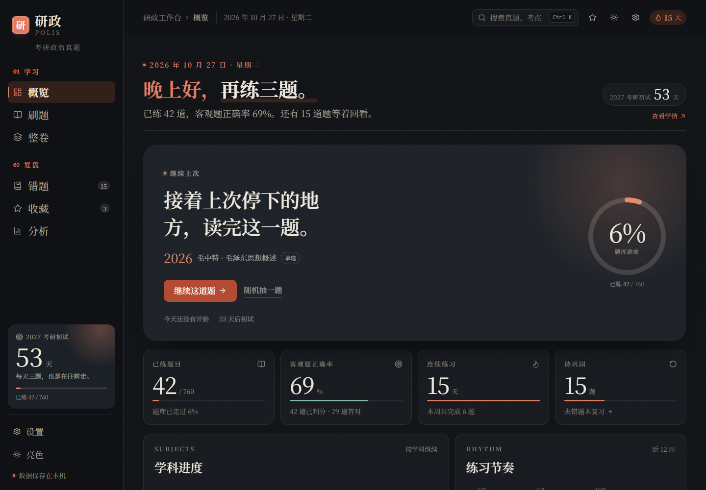

# 研政 POLIS · 考研政治真题刷题系统

一套重新设计的考研政治真题练习系统，覆盖 **2007—2026 年 760 道真题**（单选 320 / 多选 340 / 分析 100）。

不是对原题库页面的复刻，而是以「纸上朱批」为视觉概念，重做了信息架构、练习动线、判分反馈与学情分析。亮色参考 Obsidian 纸质笔记：暖纸底 + 方格、朱砂标题、蜜桃色侧栏选中；全站使用思源宋体。



<sub>深色模式下的概览页（示例数据）：继续上次、题库进度、连续练习、学科进度与练习热力图。</sub>

## 功能

- **概览**：继续上次、题库进度环、客观正确率、连续练习、待巩固、学科进度、12 周热力图、最近练习、智能训练入口。
- **刷题**：学科 / 题型 / 年份 / 专题 / 关键词筛选；**每轮 20 题**；随机练习；智能组题（错题 + 未练 + 薄弱学科）；5 列答题卡；单选、多选严格判分；分析题参考要点与自评；收藏、笔记、草稿自动保存；答满一轮出现完成总结与「再来一轮」。
- **整卷**：20 套年份卷，计时、草稿续做、交卷确认、客观题 50 分成绩单、错答 / 未答分离复盘、分析题自评。
- **错题**：待巩固 / 已掌握双状态，连续答对 2 次自动移入已掌握，支持手动标记与重练。
- **收藏**：学科筛选、关键词搜索、笔记预览。
- **分析**：学科正确率、题型环形、年份趋势、薄弱考点 Top 8、练习热力图。
- **设置**：亮色 / 暗色 / 跟随系统，题干字号，动效开关，JSON 备份导入导出，清空记录。
- **体验**：判分渐进反馈（结果条扫入、印章回弹、选项逐项标记、底部进度线）、⌘/Ctrl + K 搜索、`?` 快捷键面板、完整键盘作答、亮暗主题无闪烁、移动端筛选折叠。

## 运行

```bash
npm install
npm run dev       # http://127.0.0.1:5173
npm run build     # 产出 dist/
npm run preview   # 预览构建产物
```

要求 Node.js 20.19+（推荐 22 LTS）。

## 技术栈

- Vite 8 + React 19 + TypeScript 5.9
- motion：页面与卡片入场、解析展开、Toast
- lucide-react：线性图标
- @fontsource-variable/noto-serif-sc：思源宋体可变字体，本地打包
- 纯 CSS 设计令牌（`src/styles/tokens.css` + `global.css`），不依赖 UI 框架
- 无后端；题库 JSON 通过 fetch 加载，学习记录存于 localStorage

## 目录

```
kaoyan-politics-app/
├── DESIGN.md               # 设计说明书（调研、令牌、页面、组件、验收）
├── docs/dark-home.png      # 深色模式运行截图
├── index.html              # 首屏主题脚本
├── public/
│   ├── data/questions.json # 760 道真题
│   ├── assets/             # 3 张原卷配图
│   └── favicon.svg
├── src/
│   ├── components/         # 壳层、题目、图表、浮层、基础组件
│   ├── lib/                # 类型、数据归一化、统计、存储、工具
│   ├── pages/              # 概览 / 刷题 / 整卷 / 成绩单 / 错题 / 收藏 / 分析 / 设置
│   ├── store/              # 学习状态、判分、导入导出
│   └── styles/             # 设计令牌与全局样式
└── dist/                   # 构建产物
```

## 数据与边界

题库来自 [Nishino0525Nanase/kaoyan-politics](https://github.com/Nishino0525Nanase/kaoyan-politics)，题干与选项依公开试卷转录，解析与学习提示为整理内容，并非官方评分细则。历史真题保留考试当年的时政与表述语境，复习时请结合现行考纲。

分析题不计入客观题正确率；答案暂缺的题目明确标注、不自动判分。所有学习数据只保存在当前浏览器，清理站点数据前请先导出备份。

## 设计

完整设计说明见 [DESIGN.md](./DESIGN.md)：调研结论、品牌概念、亮暗色令牌、字体与间距、信息架构、逐页规范、组件状态、响应式、可访问性与验收记录。
